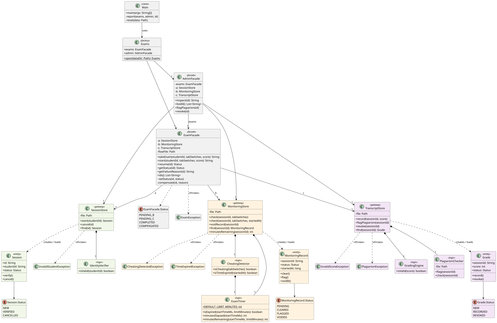

# Assignment 4: Facade, Exam Proctoring (variant 12)

A student takes an exam in three steps:

A, Identity (`exam.identity`): checks the student id and opens a session
B, Monitoring (`exam.monitoring`): counts tab switches. More than 3 is cheating.
C, Grading (`exam.grading`): checks the score and saves it.

Each subsystem has a store (saves to a file), a rule class, an entity with a status, plus its own exception.
The subsystems are not aware of each other, only in the facades.

## How to run

```bash
./gradlew run         # demo
./gradlew test        # tests + coverage report
```

To reset the saved data, run `./gradlew run --args=--reset` or delete the folder with `rm -rf app/data`.

## Demo

Pick `1` and enter a student id, tab switches and a score:

- Normal: `S1234`, `0`, `90` gives `flow=COMPLETED A=VERIFIED B=CLEARED C=RECORDED`
- B fails (cheating): `S1234`, `9`, `90` gives `flow=COMPENSATED A=CANCELLED B=FLAGGED C=-`
- C fails (bad score): `S1234`, `0`, `150` gives `flow=COMPENSATED A=CANCELLED B=VOIDED C=-`
- A fails (bad id): `bob` gives an error, nothing is saved

Other menu items:

`2` only does step A. Exit and restart the app, then `3` with the id to finish the chain.
`4` shows one exam, `5` lists all exams, `6` undoes an exam (admin).

## Facades

- `ExamFacade` (student): `takeExam()` takes A→B→C. `resume()` saves the status after each step and undoes the right steps if one fails.
- `AdminFacade` (admin): shows exams and undo one by hand.

## Saved state

Each store has its own file in `app/data/`. The chain status (`PENDING_B`, `PENDING_C`, `COMPLETED`, `COMPENSATED`) is in `flows.properties`.

The facade also checks each subsystem's saved status, so a crash anywhere is safe (never redoes an already completed step, only undoes steps that have been done).

## Least Knowledge

Before, the client knew about all the stores, the order and what to undo:

```java
Session s = sessions.start("S1234");
try {
  monitoring.check(s.id, tabSwitches);
} catch (CheatingDetectedException e) {
  sessions.cancel(s.id);
  return;
}
try {
  transcript.record(s.id, score);
} catch (InvalidScoreException e) {
  if (monitoring.find(s.id).status == MonitoringRecord.Status.CLEARED)
    monitoring.voidRecord(s.id);
  if (sessions.find(s.id).status == Session.Status.VERIFIED)
    sessions.cancel(s.id);
}
```

After, the client has only one friend:

```java
String id = exams.takeExam("S1234", tabSwitches, score);
```

`Main` only uses the two facades.

## Facade vs Adapter

The two patterns differ in intent. An Adapter is used to adapt the interface of one class to the interface expected by the client. A Facade provides a unified interface to a set of interfaces in a subsystem. In my case, there is no need to adapt anything, since all the required methods are already exposed (`start`, `check`, `record`, `cancel`, `voidRecord`, `revoke`). There is no target interface that `SessionStore`, `MonitoringStore` and `TranscriptStore` must match, and no existing API to wrap.

The actual requirement is to orchestrate the existing subsystems, not to adapt them. The single action of "take an exam" involves calling methods from three different stores in a defined order. If a step fails, the steps that already succeeded must be undone in reverse order: if `MonitoringStore` detects cheating, only the session in `SessionStore` is cancelled; if `TranscriptStore` rejects the score, the monitoring record is voided first and then the session is cancelled. The progress of the exam is also persisted, so that after a restart it can be resumed or undone. With Adapters, every store would be wrapped in another layer, but the client would still have to remember the order of operations, handle all the exceptions and decide what to undo. This logic is better encapsulated in one place, `ExamFacade.takeExam(...)`. The client does not need to know how the exam is taken, only that the Facade takes care of it. The same goes for inspecting and revoking already taken exams via `AdminFacade`.

This is why the task calls for the Facade pattern: it provides a simpler interface to a complex set of subsystems. Adapters, on the other hand, are useful when an existing API has to be converted into another one (e.g. `InputStreamReader` adapts an `InputStream` to the `Reader` interface).

## Tests

- `IdentityTest`, `MonitoringTest`, `GradingTest`: each subsystem on its own.
- `ExamFacadeTest`: normal, both failures, restarts/crashes in mid-chain.
- `AdminFacadeTest`: manual undo at each step.
- `ExamDsl`: helpers like `cheaterTakesExam()` and `assertSavedState(...)` so tests read like sentences.

Each test uses its own `@TempDir`. Line coverage is about 97% (JaCoCo). `Main` is excluded because it is the console menu.

## UML


